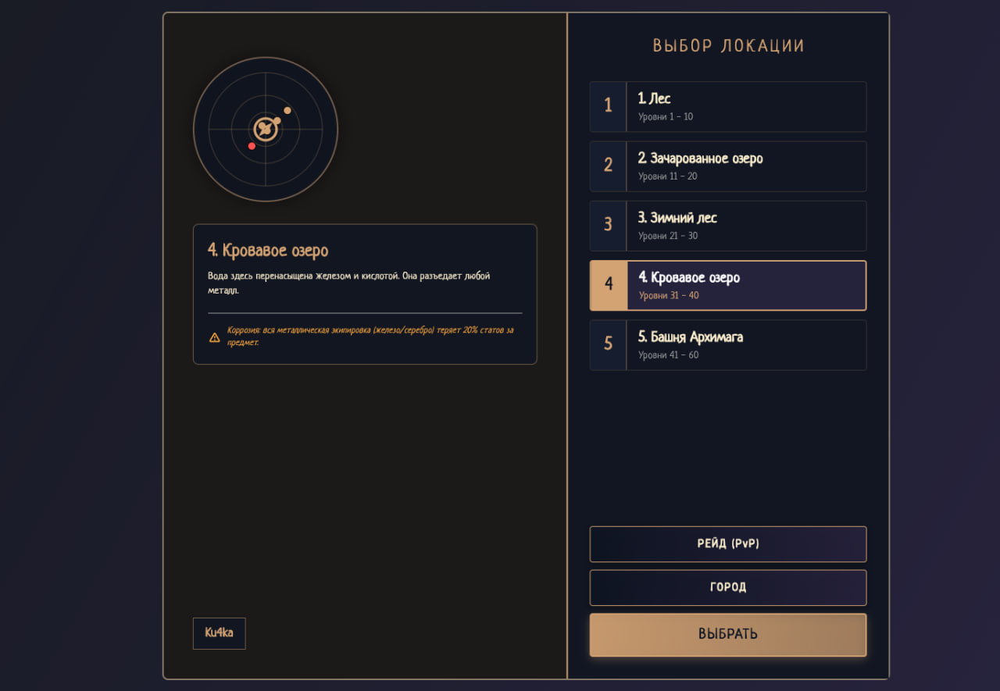
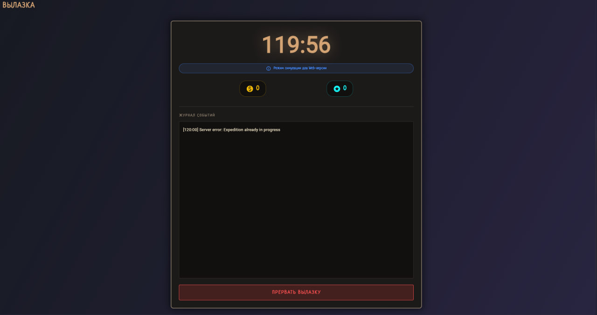
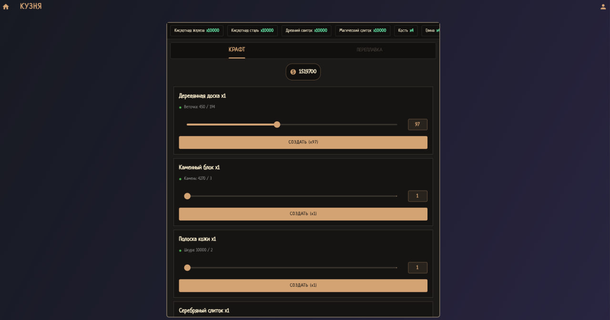
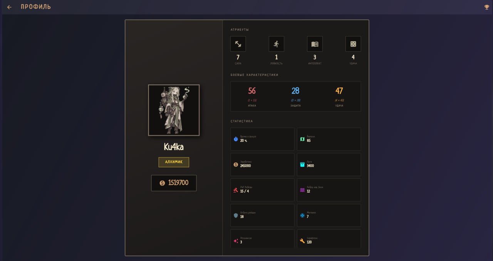

# IdleScholar

Игра в жанре Idle RPG с механикой фокус-режима. Игрок отправляется в экспедиции, зарабатывает ресурсы, крафтит экипировку и прокачивает город. В веб-версии реализована симуляция фокуса: если игрок сворачивает вкладку, таймер останавливается, а награда урезается. В проекте присутствует agent для потенциальной desktop версии, но не используется

# Требования

Только Docker и Docker Compose.

# Запуск

1. git clone https://github.com/ku4ka778/IdleScholarHackVer.git
2. cd /IdleScholarHackVer
3. docker-compose up --build -d
4. Открыть в любом браузере http://localhost

# Технический стек:

Backend: Go, gRPC(Если необходимо использовать Desktop версию с рабочим c# агентом, который блокирует домены и процессы), HTTP(Для веб версии)
Frontend: Flutter
Database: PostgreSQL
Desktop Agent(Windows only): C# (.NET 8). Реальная блокировка процессов и DNS через Win API. В Docker сборке не используется, т.к веб-версия работает в браузере и использует симуляцию фокус-режима(От python пришлось полностью отказатсься в угоду оптимизации и удобства разработки)

# !!ВАЖНО!!

Для того, чтобы оценить весь игровой контент в настройках(иконка шестеренки в окне карты) можно найти чит меню, где возможно выдать себе любой уровень и любое количество золота. Также выдается по 10 тысяч каждого ресурса и вся экипировка с улучшениями города

Специально для тестов созданы дополнительные аккаунты(для проверки механики рейдов, таблицы лидеров, кланов и т.д)

Зависимости Golang описаны в server/go.mod, Flutter -- в client/pubspec.yaml т.к Python в итоге не используется

# Скриншоты из игры

### World Map
Окно карты с выбором локации или города

### Expeditions
Окно вылазки, в котором пишется время до конца, а также награда за каждую пройденную минуту

### Forge
Возможность крафтов и переработки ресурсов и экипировки

### Character Profile
Окно статистики персонажа

